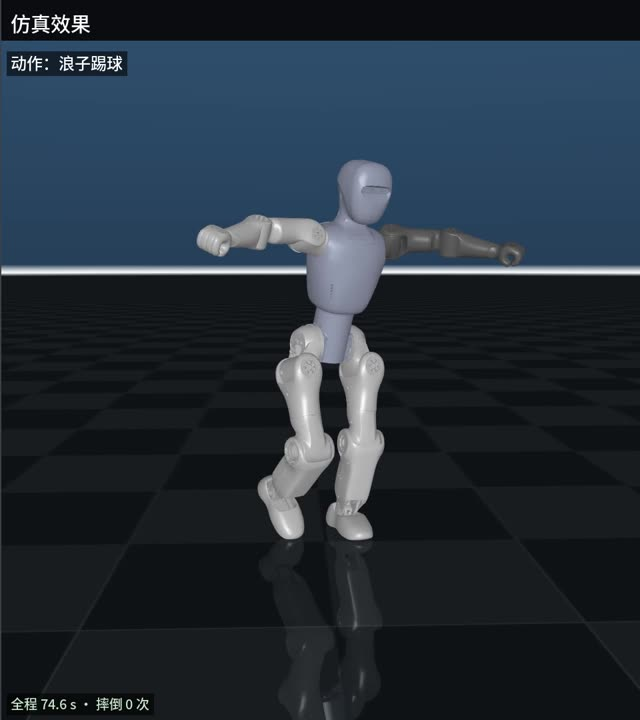

# Bumi imitation learning：从人体骨架到 SuperMimic

把逐帧的人体骨架（SMPL-X）重定向到 [Noetix Bumi](https://github.com/Noetix-Robotics/noetix_bumi_lab) 21 自由度人形机器人，再用 [SuperMimic](https://github.com/zita-ch/supermimic_vibed) 策略在 Isaac Lab 物理仿真里跟踪这段动作。

[](demo/langzi_bumi_sim.mp4)

**[完整对比视频](demo/langzi_bumi_sim.mp4)**（74.6 s，9 段舞蹈）：左上原视频，左下识别到的人体动作和机器人参考动作，右边仿真效果。全程摔倒 0 次。

目前只在仿真里验证过，没有上过实机，也没有做 MuJoCo sim2sim。

## 流程

```
人体骨架 examples/langzi/gmr_smplx_results.npz
  │  retarget/offline_retarget_smplx_npz.py   补镜头切换的空缺、IK、零相位滤波、关节限位
  ▼
机器人动作 CSV（未贴地）
  │  retarget/ground_video_retarget.py        逐帧贴地（单目估计的高度会随时间漂）
  ▼
参考动作 examples/langzi/langzi_bumi.csv
  │  supermimic/rollout_clip.py               SuperMimic 策略在 Isaac Lab 里跟踪，摔倒后 0.6 s 重置继续
  ▼
轨迹 traj.npz
  │  supermimic/render_video_demo.py          MuJoCo 回放轨迹，拼成对比视频
  ▼
demo/langzi_bumi_sim.mp4
```

策略用 LAFAN1 动捕数据训练，视频里的动作没有进训练集。

**这个仓库不包含：**

- 从视频到骨架的人体姿态估计。示例骨架由 WHAM 得到；任何能输出下文格式的估计器都可以接上。
- 预训练策略（`*.pt`）。要跑仿真，需要先按「训练策略」训练一个。
- SMPL-X 人体模型和 LAFAN1 数据集，它们的许可证不允许随仓库分发，下载方式见下文。

## 目录

| 路径 | 内容 |
|---|---|
| `retarget/` | 骨架 → 机器人动作：SMPL-X 重定向、贴地、LAFAN1 批量重定向、IK 配置推导 |
| `general_motion_retargeting/` | [GMR](https://github.com/YanjieZe/GMR) 的子集（IK 求解和 Bumi 的 IK 配置） |
| `supermimic/` | SuperMimic：`supermimic_bumi/`（仿真环境、MDP、网络）、训练、评估、仿真回放、渲染、校验 |
| `assets/noetix_bumi/` | Bumi 的 URDF（Isaac Lab 用）、MJCF（IK 和渲染用）、共用网格 |
| `examples/langzi/` | 示例：人体骨架、分段标注、重定向好的参考动作、仿真结果摘要 |
| `demo/` | 对比视频 |

## 环境

需要两个环境：

- **重定向和渲染**：Python 3.10，`pip install -r requirements-retarget.txt`。
- **仿真和训练**：Isaac Sim 5.0 + Isaac Lab（跑通时 `isaacsim` 5.0.0、`isaaclab` 0.45.0，Python 3.11，torch 2.7），另需 `tensorboard`。

SMPL-X 模型放到 `assets/body_models/smplx/SMPLX_NEUTRAL.npz`，见 [assets/body_models/README.md](assets/body_models/README.md)。

先跑离线校验，不需要 GPU，也不需要下载任何数据：

```bash
python supermimic/check_offline.py
```

## 从人体骨架到仿真

**1. 重定向**（重定向环境）

```bash
python retarget/offline_retarget_smplx_npz.py --npz examples/langzi/gmr_smplx_results.npz \
    --segments examples/langzi/segments.json --n_frames 2240 --out out/langzi_raw.csv
python retarget/ground_video_retarget.py --in out/langzi_raw.csv --out out/langzi_bumi.csv
```

输出的 CSV 每行是根位置、根四元数（xyzw）、21 个关节角（MJCF 顺序），30 fps。对示例数据，结果应与 `examples/langzi/langzi_bumi.csv` 一致。

**2. 仿真**（Isaac Lab 环境）

```bash
python supermimic/rollout_clip.py --headless --ckpt logs/<run>/ckpt_040000.pt \
    --clips examples/langzi/langzi_bumi.csv --out out/traj.npz
```

和 `evaluate.py` 同一套条件：摩擦 1、无随机化、指令延迟 2 个物理步、确定性策略。

**3. 渲染**（重定向环境）

除轨迹外，还需要原视频、人体网格叠加视频、裁剪后的原视频，这些由姿态估计那一步产生。中文标题需要 `fonts-noto-cjk-extra` 字体。

```bash
MUJOCO_GL=egl python supermimic/render_video_demo.py --traj out/traj.npz --video <原视频> --overlay <网格叠加视频> \
    --crop <裁剪后的原视频> --segments examples/langzi/segments.json --plain --out out/demo.mp4
ffmpeg -i out/demo.mp4 -i <原视频> -map 0:v -map 1:a -c:v copy -c:a aac -shortest out/demo_audio.mp4   # 加回原音轨
```

`--plain` 只显示中性标题，不显示方法和检查点名称。

### 输入格式

**骨架 `.npz`**：

| 键 | 形状 | 含义 |
|---|---|---|
| `root_orient` | (N, 3) | 根朝向，轴角 |
| `pose_body` | (N, 63) | 21 个身体关节的局部旋转，轴角 |
| `trans` | (N, 3) | 根平移，米 |
| `betas` | (10,) | SMPL-X 体型系数，身高按 `1.66 + 0.1 * betas[0]` 估计 |
| `mocap_frame_rate` | 标量 | 帧率 |
| `coord_system` | 标量 | 必须是 `"y-up"` |

**分段 `segments.json`**（可选）：

- `gaps`：`[起始帧, 结束帧)` 列表，标记估计不可靠的帧（标题卡、特写、镜头切换）。这些帧在 SMPL-X 空间里插值补齐。
- `moves`：`[名称, 起始帧, 结束帧]` 列表，只用于在视频上标注动作名。

**剪辑过的视频要先处理**：标题卡和特写会让姿态估计虚构出一个坐着的人，而且跟踪器会把同一条轨迹带过镜头切换。先把这些帧涂黑再跑估计，让每个镜头各起一条轨迹，再用 `gaps` 补齐。分屏视频要先裁出单人。

## 训练策略

下载 [LAFAN1](https://github.com/ubisoft/ubisoft-laforge-animation-dataset) 的 BVH，重定向并贴地，放到 `data/lafan1_bumi_grounded/`（`supermimic/motions/bumi_lafan40.txt` 按这个路径列了 40 段，约 2.45 h）：

```bash
python retarget/bvh_to_robot_batch_headless.py --bvh_dir <LAFAN1 目录> --out_dir data/lafan1_bumi --workers 12 \
    --only $(grep -v '^#' supermimic/motions/bumi_lafan40.txt | xargs -n1 basename | sed 's/.csv//')
python retarget/ground_retargets.py --in_dir data/lafan1_bumi --out_dir data/lafan1_bumi_grounded
```

然后在 Isaac Lab 环境里训练和评估。4096 个环境、1000 步缓冲区、`--grad_ckpt` 在 16 GB 显存上能跑，但放不下同时运行的评估：

```bash
PYTHON=$(which python) supermimic/run_train.sh <run> --iterations 40000   # systemd 用户单元，日志在 logs/<run>/train.out
PYTHON=$(which python) supermimic/eval_after_train.sh <run> 3             # 等训练结束后评估全部检查点，结果在 logs/<run>/eval.csv
```

`supermimic/check_sim.py --headless`（约 3 GB 显存）检查 PhysX 里实际生效的增益、限位、质量，以及运动学和 PhysX 刚体位姿是否一致。

## 结果

**训练**：40 段 LAFAN1，40000 次迭代，评估归一化回报 0.816，40 段全部跟完。

**示例视频**（`ckpt_040000`，摘要见 `examples/langzi/traj_040000_summary.json`）：

| 指标 | 数值 |
|---|---|
| 时长 | 74.6 s |
| 摔倒次数 | 0 |
| 归一化回报 | 0.79 |
| 身体位置 RMS 误差 | 4.9 cm |

**已知不足：**

- **抬脚偏低**：脚抬起的高度大约只有参考的 1/3，例如踢腿 0.08 m 对参考 0.23 m。32k、36k、40k 三个检查点都是如此。
- **全局位置漂移**：整段向前漂 0.4–1 m，因为奖励对全局位置的约束较弱。
- **手臂下垂时肘部弯曲**：Bumi 肩宽、臂短，重定向结果和 LAFAN1 训练数据都是这样。

## 重定向和 Bumi 适配要点

**SMPL-X IK 配置**（`retarget/derive_smplx_ik_from_g1.py`）由 GMR 的 G1 配置推导：

- 旋转偏置 `O_robot = O_G1 · R_G1(q=0)ᵀ · R_robot(q_eq)`，`q_eq` 是肘 -90°（G1 零位前臂朝前）。
- 尺度：根 0.5455 = 0.9 × 直腿根高比 0.480/0.792；腿部按到根的距离比；手臂 0.645 = 0.8 × 臂长比 0.806。
- MJCF 加了无质量的 `l/r_hand_link`（Bumi 没有手腕）和 `l/r_toe_link`（SMPL-X 的 foot 关节其实在脚趾）。
- 首帧从站姿热启动，否则 IK 可能卡在前趴的局部极小值里。

**SuperMimic 仿真**对齐 noetix_bumi_lab 的 `Mimic-Bumi-v0`：

| 项 | 取值 |
|---|---|
| 模型 | `bumi.urdf`（BUMI V3.0），17.3 kg，直腿根高 0.48 m |
| 执行器 | 隐式 PD + 指令延迟，kp/kd/力矩/速度限位同 `BUMI_21DOF_CFG`，只有踝有 armature 0.01 |
| 动作 scale | 逐关节 0.25 · effort / stiffness（腿 0.11–0.33，臂 0.115，踝 0.325） |
| 延迟 | 0–4 物理步，评估固定 2 |
| 零点噪声 | 全部 ±0.02 |
| ξ（环境参数） | 26 维：摩擦、21 个零点、`waist_yaw_link` 质心、延迟 |
| 跟踪刚体 | 14 个（base、髋 pitch/yaw、膝、踝 roll、waist、肩 roll、肘） |
| 关节顺序 | Isaac Sim 5.0 是广度优先、同级按名字排序；环境里按名字映射，不依赖这个顺序 |

Noetix 训练里的推搡、躯干质量 ±3 kg、PD 增益 ±20% 随机化没有加。Noetix 自带的 `mimic_data/bumi/2.npz` 没进训练集，它是旧版腿部几何录的（21 个关节坐标系里 14 个和 `bumi.urdf` 不同）。

## 许可证

本仓库自己的代码使用 [MIT](LICENSE)。下表中的第三方内容保留各自的许可证，`demo/` 和 `examples/langzi/` 不在 MIT 授权范围内（见表后说明）。

| 内容 | 来源 | 许可证 |
|---|---|---|
| `general_motion_retargeting/` | [GMR](https://github.com/YanjieZe/GMR)，有改动 | MIT，[third_party_licenses/LICENSE-GMR](third_party_licenses/LICENSE-GMR) |
| `supermimic/` | [supermimic_vibed](https://github.com/zita-ch/supermimic_vibed)（Chong Zhang，ETH Zurich），已适配 Isaac Lab + Bumi | MIT，[third_party_licenses/LICENSE-supermimic_vibed](third_party_licenses/LICENSE-supermimic_vibed) |
| `assets/noetix_bumi/` | [noetix_bumi_lab](https://github.com/Noetix-Robotics/noetix_bumi_lab)，commit `2454535c` | BSD-3-Clause，[third_party_licenses/LICENSE-noetix_bumi_lab.txt](third_party_licenses/LICENSE-noetix_bumi_lab.txt) |
| SMPL-X 人体模型 | [smpl-x.is.tue.mpg.de](https://smpl-x.is.tue.mpg.de/) | 不在仓库内，需自行下载 |
| LAFAN1 数据集 | [Ubisoft La Forge](https://github.com/ubisoft/ubisoft-laforge-animation-dataset) | 不在仓库内，需自行下载 |

`demo/langzi_bumi_sim.mp4` 里的原视频及其音轨版权归原作者，这里只用来展示动作来源。`examples/langzi/` 的骨架和参考动作由这段视频估计得到，仅作为运行示例提供。
